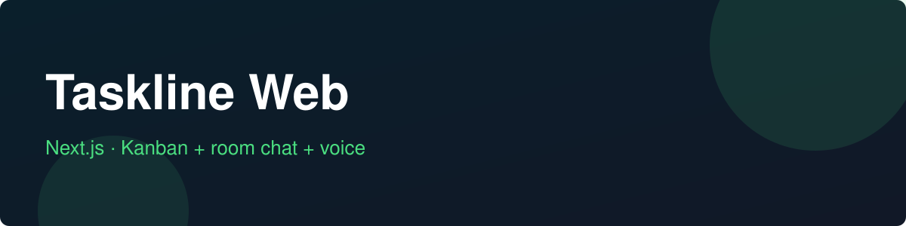

# Taskline Web

 

Next.js frontend for **Taskline** — kanban boards with minimal room chat and WebRTC voice.

## Features (planned)
- Drag-and-drop boards (dnd-kit)
- Room chat UI + raw WebRTC voice client
- Auth + realtime presence

## Stack
Next.js 15 (App Router) · React 19 · TypeScript

## Related
API: [taskline-api](https://github.com/plucasr/taskline-api)

## Status
Actively built over 60 days — see [TODO.md](TODO.md) for the traceable plan.
